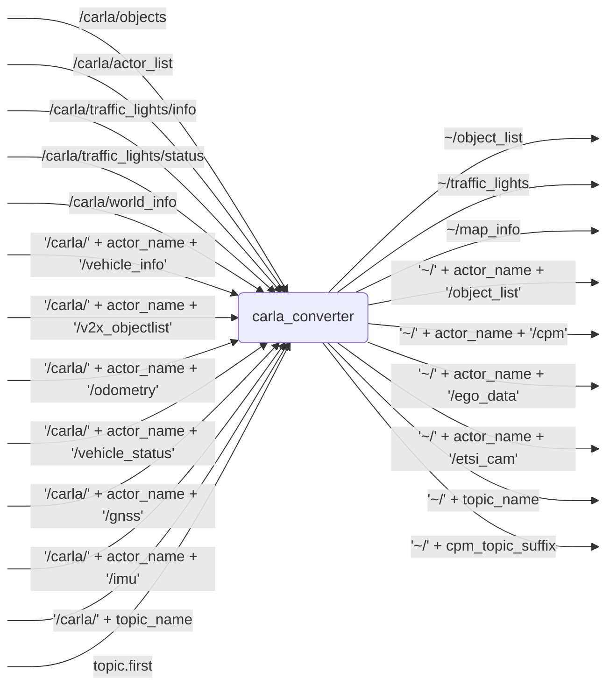

# `carla_converter`

Converter for CARLA specific ROS 2 data to OpenADS interfaces.

## Nodes

### `carla_converter`

#### Subscribed Topics

| Topic | Type | Description |
| --- | --- | --- |
| `/carla/objects` | `derived_object_msgs/msg/ObjectArray` | Objects in the CARLA environment |
| `/carla/actor_list` | `carla_msgs/msg/CarlaActorList` | CARLA actor list, used to resolve actor ids of configured actors (e.g. infrastructure units without `vehicle_info`) and to discover vehicle actors without individual topics for `cam_penetration_rate` |
| `/carla/traffic_lights/info` | `carla_msgs/msg/CarlaTrafficLightInfoList` | Global traffic light information |
| `/carla/traffic_lights/status` | `carla_msgs/msg/CarlaTrafficLightStatusList` | Global traffic light status |
| `/carla/world_info` | `carla_msgs/msg/CarlaWorldInfo` | CARLA world/map info |
| `"/carla/" + actor_name + "/vehicle_info"` | `carla_msgs/msg/CarlaEgoVehicleInfo` | Vehicle metadata for actors from `ego_data_actors` and `object_list_actors` |
| `"/carla/" + actor_name + "/v2x_objectlist"` | `derived_object_msgs/msg/ObjectArray` | Actor's own ideal object sensor feed, for each actor from `cpm_actors` |
| `"/carla/" + actor_name + "/odometry"` | `nav_msgs/msg/Odometry` | Odometry for each actor from `ego_data_actors` |
| `"/carla/" + actor_name + "/vehicle_status"` | `carla_msgs/msg/CarlaEgoVehicleStatus` | Vehicle status for each actor from `ego_data_actors` |
| `"/carla/" + actor_name + "/gnss"` | `sensor_msgs/msg/NavSatFix` | GNSS fix for each actor from `ego_data_actors` |
| `"/carla/" + actor_name + "/imu"` | `sensor_msgs/msg/Imu` | IMU data for each actor from `ego_data_actors` |
| `"/carla/" + topic_name` | `derived_object_msgs/msg/ObjectArray` | Custom CARLA ObjectArray topics that are subscribed and converted automatically |
| `topic.first` | `perception_msgs/msg/ObjectList` | Any object list topic matching `cpm_topic_pattern` (and not published by this node) is subscribed and converted to CPM automatically |

#### Published Topics

| Topic | Type | Description |
| --- | --- | --- |
| `~/object_list` | `perception_msgs/msg/ObjectList` | Output topic for converted object list |
| `~/traffic_lights` | `perception_msgs/msg/ObjectList` | Output topic for converted traffic lights |
| `~/map_info` | `std_msgs/msg/String` | Output topic for map info |
| `"~/" + actor_name + "/object_list"` | `perception_msgs/msg/ObjectList` | Object list transformed into each actor frame from `object_list_actors` |
| `"~/" + actor_name + "/cpm"` | `etsi_its_cpm_ts_msgs/msg/CollectivePerceptionMessage` | Object list converted to CPM for each actor from `cpm_actors` (requires simulation time to be current unix time) |
| `"~/" + actor_name + "/ego_data"` | `perception_msgs/msg/EgoData` | Ego state for each actor from `ego_data_actors` |
| `"~/" + actor_name + "/etsi_cam"` | `etsi_its_cam_msgs/msg/CAM` | Ego state converted to CAM for each actor from `ego_data_actors` and each actor selected via `cam_penetration_rate` (requires simulation time to be current unix time) |
| `"~/" + topic_name` | `perception_msgs/msg/ObjectList` | Converted output for each custom CARLA ObjectArray topic |
| `"~/" + cpm_topic_suffix` | `etsi_its_cpm_ts_msgs/msg/CollectivePerceptionMessage` | CPM for each topic discovered via `cpm_topic_pattern` (a trailing `object_list` is replaced by `cpm`, otherwise `/cpm` is appended; requires the source header stamp to be current unix time) |

#### Parameters

| Parameter | Type | Default | Description |
| --- | --- | --- | --- |
| `ego_data_actors` | `string` | `"ego_vehicle"` | Comma-separated list of actor names to publish ego data for |
| `object_list_actors` | `string` | `"ego_vehicle"` | Comma-separated list of actor names to publish object lists for |
| `cpm_actors` | `string` | `""` | Comma-separated subset of object_list_actors to publish CPM messages. Each actor's CPM is sourced from its own ideal object sensor topic (/carla/<actor_name>/v2x_objectlist). Use cpm_topic_pattern instead if an actor has no such topic but publishes a custom object list. |
| `cpm_topic_pattern` | `string` | `""` | Regex matched against discovered perception_msgs/ObjectList topics; matching topics not already published by this node get an additional CPM conversion and publisher. |
| `pos_variances` | `float` | `0.0` | Position variance [m^2] |
| `vel_variances` | `float` | `0.0` | Velocity variance [m^2/s^2] |
| `acc_variances` | `float` | `0.0` | Acceleration variance [m^2/s^4] |
| `angle_variances` | `float` | `0.0` | Angle variance [rad^2] |
| `angle_rate_variances` | `float` | `0.0` | Angle rate variance [rad^2/s^2] |
| `steering_angle_ack_variance` | `float` | `0.0` | Ackermann steering angle variance [rad^2] |
| `standstill_threshold` | `float` | `0.01` | Velocity threshold to indicate standstill of vehicle [m/s] |
| `enable_traffic_lights` | `bool` | `false` | Enable traffic light subscriptions and publishing |
| `traffic_light_frequency` | `float` | `10.0` | Publishing frequency for traffic lights [Hz] |
| `carla_fixed_frame_id` | `string` | `"carla_map"` | Fixed frame ID used for the CARLA map |
| `cam_penetration_rate` | `float` | `0.0` | Percentage of vehicle actors (besides those in ego_data_actors, which always send CAM) that additionally send CAM messages |

## Launch Files

### [`carla_converter.launch.py`](launch/carla_converter.launch.py)

| Argument | Default | Description |
| --- | --- | --- |
| `object_list_topic` | `"~/object_list"` | Output topic for converted object list |
| `traffic_lights_topic` | `"~/traffic_lights"` | Output topic for converted traffic lights |
| `map_info_topic` | `"~/map_info"` | Output topic for map info |
| `name` | `"carla_converter"` | Node name |
| `namespace` | `""` | Node namespace |
| `params` | `os.path.join(get_package_share_directory("carla_converter"), "config", "params.yml")` | Path to parameter file |
| `log_level` | `"info"` | ROS logging level (debug, info, warn, error, fatal) |
| `use_sim_time` | `"true"` | Use simulation clock |

### [`transforms.launch.py`](launch/transforms.launch.py)
